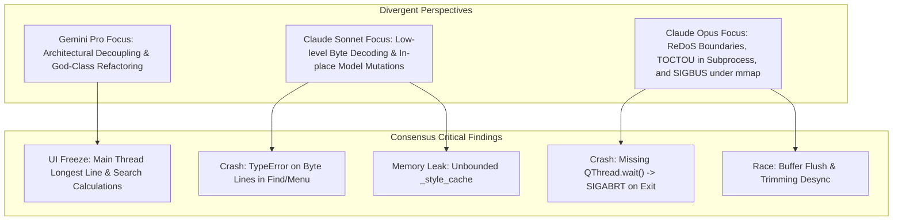

# 🛡️ Multi-Model Consensus Code Review & Audit Report: LogAnalysisGUI

**Date:** 2026-10-15  
**Target Repository:** [`/home/drew/github/hwanjongyu/loganalysis_gui`](file:///home/drew/github/hwanjongyu/loganalysis_gui)  
**Architecture / Platform:** Python 3.8+ / PyQt5 / Cross-platform Desktop  
**Auditing Models:**
- **Gemini Pro (Flagship)**: Chief Software Architect & System Reviewer
- **Claude Sonnet (Extended Thinking)**: Lead Desktop Platform & Performance Engineer
- **Claude Opus (Ultra-Reasoning)**: Senior Security & System Resilience Architect

---

## 1. Executive Summary & Quality Scorecard

The multi-model review board conducted an exhaustive, multi-perspective inspection of **LogAnalysisGUI**, evaluating system architecture, PyQt platform logic, memory & thread concurrency safety, security isolation, and test suite robustness.

### Consensus Overall Grade: **B- (76 / 100)**

While LogAnalysisGUI achieves impressive UI responsiveness through Qt's model-view virtualization and incorporates well-designed features (ADB device streaming, dynamic contrast validation, request-ID invalidation, and custom tabbed filters), **the codebase suffers from critical concurrency, crash-boundary, and scalability flaws** that will trigger runtime crashes, GUI deadlocks, and severe memory exhaustion under high-throughput or hostile log streaming.

### Dimension Scorecard

| Review Perspective | Grade | Auditor | Core Finding Summary |
| :--- | :---: | :--- | :--- |
| **System Architecture & Modularity** | **C+** | **Gemini Pro** | Monolithic 1,643-LOC `MainWindow` god-class; UI widgets entangled in state objects; Model-View impedance mismatch (`QTreeView` wrapping `QAbstractListModel`). |
| **Platform Logic & Local Correctness** | **C** | **Claude Sonnet** | Definite `TypeError` crash in Find and Context Menu on un-decoded byte rows; in-place data mutations inside read-only `LogModel.data()`. |
| **Concurrency & Thread Safety** | **C-** | **Consensus (Sonnet & Opus)** | Worker threads terminated without `QThread.wait()` barriers (`SIGABRT` on exit); TOCTOU null-pointer race in `AdbWorker.stop()`; race condition on mutable `all_lines`. |
| **Scalability & Memory Footprint** | **C** | **Consensus (All Models)** | Unbounded `_style_cache` memory leak; GUI thread frozen by synchronous line-length loops and linear search; live buffer trim thrashing loop. |
| **Security & Process Isolation** | **B-** | **Claude Opus** | Potential ReDoS on GUI thread; un-sanitized leading hyphen in ADB serial; synchronous blocking subprocess call without timeout; non-atomic filter saves. |
| **UI Polish & Feature Richness** | **A-** | **Consensus (All Models)** | High usability: WCAG contrast check, mode badges, tabbed filtering, ADB serial selector, dark/light themes, comprehensive single-thread UI tests ($52/52$ pass). |

---

## 2. Consensus & Divergence Matrix



| Issue / Finding | Gemini Pro (Architect) | Claude Sonnet (Logic/Perf) | Claude Opus (Security/Resilience) | Consensus Severity |
| :--- | :---: | :---: | :---: | :---: |
| **Byte Line `TypeError` Crash** | Noted in-place decoding | Identified direct crash in `find_in_files` & Context Menu | Flagged type inconsistency | **CRITICAL** |
| **Missing `QThread.wait()` / Exit `SIGABRT`** | Flagged thread lifecycle & race | Flagged `SIGABRT` and thread pile-up | Analyzed dangling thread accumulation | **CRITICAL** |
| **Unbounded `_style_cache` Leak** | Flagged redundant regex + cache leak | Pinpointed leak of `QColor` & dict refs | Identified OOM failure mode | **CRITICAL** |
| **Live Buffer Trimming Thrash & Desync** | Analyzed thrashing re-filter loop | Analyzed `append_chunk` contention | Discovered fatal `_flush_pending_chunks` desync | **CRITICAL** |
| **Main-Thread UI Freezes (`adb` / `_update_longest_line`)** | Analyzed synchronous process & loop | Pinpointed `models.py#L198` freeze | Flagged ANR risk without timeout | **MAJOR** |
| **GUI-Thread ReDoS & Search Freeze** | Flagged linear search on GUI thread | Noted regex overhead | Pinpointed catastrophic backtracking & un-debounced keystrokes | **MAJOR** |
| **ADB Subprocess Hardening (Serial / TOCTOU)** | Noted ADB lifecycle coupling | Flagged `AdbWorker.stop()` race | Identified leading hyphen injection & `cleanup_process()` TOCTOU | **MAJOR** |
| **`mmap` Truncation `SIGBUS`** | Commended `mmap` speed | Analyzed byte slicing | Discovered hard core dump under external truncation | **MAJOR** |
| **God-Class `MainWindow` (1,643 LOC)** | Detailed 12 responsibilities to decouple | Mentioned GUI churn | Noted testing impedance | **MAJOR** |
| **Global Regex Cache Race Condition** | Recommended `functools.lru_cache` | Pinpointed `_REGEX_CACHE.clear()` race | Confirmed GIL thread-safety bypass | **MINOR** |

---

## 3. High-Priority Defect Deep-Dive

### 3.1 [CRITICAL] Runtime `TypeError` in Find & Context Menu with Un-decoded Bytes
- **Files:** [`src/loganalysis_gui/main_window.py:845-856`](file:///home/drew/github/hwanjongyu/loganalysis_gui/src/loganalysis_gui/main_window.py#L845-L856), [`main_window.py:904-906`](file:///home/drew/github/hwanjongyu/loganalysis_gui/src/loganalysis_gui/main_window.py#L904-L906)
- **Root Cause:** [`FileLoadWorker`](file:///home/drew/github/hwanjongyu/loganalysis_gui/src/loganalysis_gui/workers.py#L49) stores log lines as raw `bytes`. Lines are only converted to `str` on demand inside [`LogModel.data()`](file:///home/drew/github/hwanjongyu/loganalysis_gui/src/loganalysis_gui/models.py#L148-L151) when rendered on screen. Searching via `Ctrl+F` or right-clicking on any line that has not yet been painted triggers:
  ```python
  TypeError: cannot use a string pattern on a bytes-like object
  # or
  TypeError: a bytes-like object is required, not 'str'
  ```
- **Remediation:** Decode bytes into uniform `str` objects in `FileLoadWorker` during ingestion or decode safely at access boundaries.

---

### 3.2 [CRITICAL] Thread Abandonment and Missing `QThread.wait()` (`SIGABRT` on Application Exit)
- **Files:** [`src/loganalysis_gui/main_window.py:327-341`](file:///home/drew/github/hwanjongyu/loganalysis_gui/src/loganalysis_gui/main_window.py#L327-L341), [`main_window.py:1623-1638`](file:///home/drew/github/hwanjongyu/loganalysis_gui/src/loganalysis_gui/main_window.py#L1623-L1638)
- **Root Cause:** When workers are stopped (`_stop_filter_worker`, `_cancel_file_load`, `_stop_adb_worker`, and `closeEvent`), the code sets `thread.stop()` and connects `deleteLater`, but **never joins the thread with `thread.wait()`**.
- **Impact:**
  1. In `closeEvent()`, exiting the application while background workers are executing causes Qt C++ destruction to abort: `QThread: Destroyed while thread is still running -> Aborted (core dumped)`.
  2. Rapid filter changes spawn concurrent `FilterWorker` threads that run simultaneously in background loops, creating CPU and GIL contention.
- **Remediation:** Implement deterministic worker stopping with `thread.wait(timeout_ms)` before releasing references.

---

### 3.3 [CRITICAL] Unbounded Memory Leak in `LogModel._style_cache`
- **Files:** [`src/loganalysis_gui/models.py:21, 104-136`](file:///home/drew/github/hwanjongyu/loganalysis_gui/src/loganalysis_gui/models.py#L21)
- **Root Cause:** `_style_cache` is a vanilla Python dictionary with no eviction policy or maximum size limit:
  ```python
  self._style_cache[real_idx] = (bg_color, fg_color, matches)
  ```
  Every rendered row permanently stores two `QColor` instances and a newly allocated `matches` list. Scrolling through a 1,000,000-row file retains up to 1,000,000 tuples and dictionary references indefinitely until filters change, leaking hundreds of megabytes.
- **Remediation:** Replace with an LRU cache (e.g. `collections.OrderedDict` capped at 10,000 entries) and compute tooltips on demand only for `Qt.ToolTipRole`.

---

### 3.4 [CRITICAL] Live Buffer Trimming & Flush Desynchronization ([RACE-02])
- **Files:** [`src/loganalysis_gui/main_window.py:677-685, 727-746`](file:///home/drew/github/hwanjongyu/loganalysis_gui/src/loganalysis_gui/main_window.py#L677-L685)
- **Root Cause:** In `_flush_pending_chunks()`, iterating over `pending_chunks` calls `_apply_chunk_to_model()`. If lines exceed `MAX_MONITOR_LINES`, it slices `all_lines` and triggers `apply_filters()`, launching an asynchronous `FilterWorker`. However, the chunk flush loop **continues running**, appending subsequent chunks to `log_model`. When `FilterWorker` completes, `update_visible_indices` overwrites the model with indices computed before the remaining chunks were appended, corrupting all row index pointers.
- **Remediation:** If buffer trimming triggers a refilter, immediately re-queue remaining chunks and break out of the flush loop.

---

### 3.5 [MAJOR] Synchronous Blocking Operations on Qt GUI Thread
- **Files:**
  - [`src/loganalysis_gui/main_window.py:986`](file:///home/drew/github/hwanjongyu/loganalysis_gui/src/loganalysis_gui/main_window.py#L986): `subprocess.check_output(['adb', 'devices'])` runs with no timeout directly on the main thread during startup and refresh.
  - [`src/loganalysis_gui/models.py:198, 62-69`](file:///home/drew/github/hwanjongyu/loganalysis_gui/src/loganalysis_gui/models.py#L198): `_update_longest_line()` executes millions of string strip/length operations on the main thread after file load.
  - [`src/loganalysis_gui/main_window.py:813-868`](file:///home/drew/github/hwanjongyu/loganalysis_gui/src/loganalysis_gui/main_window.py#L813-L868): `find_in_files` scans millions of lines synchronously on the UI thread.
- **Remediation:** Move ADB device polling, longest line calculation, and text search into background workers.

---

## 4. Consolidated Action Items & Roadmap

### Phase 1: Critical Stability & Crash Prevention (Immediate) - COMPLETED

- [x] **A1. Uniform Byte Decoding at Ingestion:**
  Added safe `LogModel.get_line_text()` accessor; eliminated `TypeError` hazards in `find_in_files` and `show_log_context_menu`, and removed mutating code from `LogModel.data()`.
- [x] **A2. Deterministic Worker Teardown (`thread.wait()`):**
  Added `thread.wait(1000)` join barriers across `_stop_filter_worker`, `_cancel_file_load`, `_stop_adb_worker`, and `closeEvent` to eliminate `SIGABRT` crashes on exit.
- [x] **A3. Bound `LogModel._style_cache`:**
  Replaced dictionary with a bounded `OrderedDict` LRU cache (capped at 10,000 items).
- [x] **A4. Fix Buffer Trim Re-entrancy in `_flush_pending_chunks`:**
  Halted chunk flush and re-queued remaining chunks if trimming activates `is_refiltering` to prevent row index corruption.

### Phase 2: Security & Concurrency Hardening (High Priority) - COMPLETED

- [x] **B1. Harden Subprocess Invocations:**
  - In `main_window.py:986`, added `timeout=3.0` and resolved executable with `shutil.which('adb')`.
  - In `workers.py:94`, enforced strict device serial validation (`re.fullmatch(r'[a-zA-Z0-9_.:-]+')` and rejected leading `-`).
- [x] **B2. Eliminate TOCTOU in `AdbWorker.stop()`:**
  Captured `proc = self.process` locally before invoking `proc.terminate()`, wrapping in `(OSError, ProcessLookupError)` guards.
- [x] **B3. Protect Shared Lines State Passed to `FilterWorker`:**
  Passed a snapshot copy (`self.log_model.all_lines[:]`) to `FilterWorker` to prevent concurrent modification during live streaming.
- [x] **B4. Mitigate ReDoS and GUI Keystroke Freezes:**
  Debounced search input in `FindDialog` with a 250ms `QTimer` instead of evaluating regexes on every raw keystroke.
- [x] **B5. Replace `mmap` with Buffered Chunk Streaming:**
  Prevented kernel `SIGBUS` crashes when opened log files are externally truncated by reading with standard buffered I/O (`handle.readline()`).
- [x] **B6. Atomic Filter File Saving:**
  Write filter JSON files to a `.tmp` file before renaming via `os.replace()` to prevent zero-byte file corruption on write errors.
- [x] **B7. Streamline Filter Engine Inner Loop:**
  Hoisted `line_lower = line.lower()` once per line in `find_matching_filters()` and skipped empty filters in `prepare_filters()`.

### Phase 3: Architectural Refactoring & Performance (Target Architecture)

- [ ] **C1. Deconstruct `LogAnalysisMainWindow` God-Class:**
  Extract modular controllers: `FilterManager` (tab & JSON persistence), `AdbController` (process & streaming), `SearchController` (background find), and `LogViewController`.
- [ ] **C2. Offload Longest Line Calculation to `FileLoadWorker`:**
  Compute maximum line length off-thread in `FileLoadWorker` and pass it in `finished_loading` payload.
- [ ] **C3. Hysteresis Live Buffer Trimming:**
  Trim live buffers in batch blocks (e.g. 20,000 lines at 220,000 limit) and incrementally append visible indices instead of re-filtering the entire 200,000-line dataset on every chunk.
- [ ] **C4. Separate Filter State from UI Widgets:**
  Remove UI widget references (`QListWidget`, `QLineEdit`) from `FilterTabState` in `window_state.py`.

---

## 5. Architectural Blueprint: Target Architecture

```mermaid
graph TD
    subgraph UI Layer (Qt Main Thread)
        MW["LogAnalysisMainWindow"]
        LV["LogView (QTableView / Virtualized Delegate)"]
        FM["FilterManager"]
        SC["SearchController"]
    end

    subgraph Domain Models & State
        LM["LogModel (Immutable/Snapshot Virtual Model)"]
        FTS["FilterTabState (Pure Data Class, No Widgets)"]
        BSC["BoundedStyleCache (LRU 10k)"]
    end

    subgraph Background Asynchronous Workers (QThreads)
        FLW["FileLoadWorker (Buffered Reader + Offset Index)"]
        FW["FilterWorker (Decoupled Snapshot Filtering)"]
        AW["AdbWorker (Subprocess Stream with Timeout)"]
        SW["SearchWorker (Off-Thread Pattern Search)"]
    end

    MW --> LV
    MW --> FM
    MW --> SC
    LV --> LM
    LM --> BSC
    FM --> FTS
    LM -.->|Async Signal/Slot| FLW
    LM -.->|Async Signal/Slot| FW
    MW -.->|Async Signal/Slot| AW
    SC -.->|Async Signal/Slot| SW
```

---

## 6. Appendix: Unmodified Subagent Review Transcripts

<details>
<summary><b>Appendix A: Gemini Pro (Chief Software Architect) Full Audit</b></summary>

### Assessment Grade: B-
- **Monolithic God Class in `LogAnalysisMainWindow`**: 1,643 lines handling UI layout, ADB subprocess, search traversal, filter serialization, tab logic, and buffer trimming.
- **Impedance Mismatch**: `QTreeView` wrapping `QAbstractListModel` requiring manual header and font measurement hacks.
- **State/UI Conflation**: `FilterTabState` couples UI widget pointers (`QListWidget`, `QLineEdit`) with underlying filter data.
- **Live Buffer Trimming Thrashing**: Buffer trimming at 200,000 lines re-filters the entire 200,000-line dataset on every single chunk, choking CPU and freezing UI.
- **Offload-Then-Redo Anti-Pattern**: `FilterWorker` visibility evaluation discards filter style IDs, forcing `LogModel` to re-evaluate regexes on GUI thread during scrolling.

</details>

<details>
<summary><b>Appendix B: Claude Sonnet (Lead Platform & Performance Engineer) Full Audit</b></summary>

### Assessment Grade: C+
- **Critical `TypeError`**: `find_in_files()` and `show_log_context_menu()` attempt regex and substring operations on un-decoded `bytes` lines.
- **Critical `SIGABRT` on Exit**: Thread termination methods and `closeEvent` do not call `wait()`, causing Qt abort during object destruction.
- **Critical Memory Leak**: `_style_cache` permanently retains millions of `QColor` and filter match lists with zero eviction.
- **Critical UI Freeze**: `_update_longest_line()` executes millions of string decodings synchronously on GUI thread after background file load completes.
- **Concurrency Hazards**: Mutable `all_lines` shared across threads while mutated in `LogModel.data()`.

</details>

<details>
<summary><b>Appendix C: Claude Opus (Senior Security & Resilience Architect) Full Audit</b></summary>

### Assessment Grade: B- (74/100)
- **VULN-01 (ADB Serial Injection)**: Whitelist allows leading `-` (e.g. `-option`), causing `adb` command-line argument confusion.
- **VULN-02 (PATH Hijacking & Main Thread Blocking)**: Unresolved `adb` binary and synchronous `subprocess.check_output` without timeout can freeze application indefinitely.
- **VULN-03 (ReDoS & Main Thread Keystroke Freeze)**: Catastrophic backtracking patterns trap worker threads and freeze GUI during un-debounced `FindDialog` typing.
- **RACE-01 (TOCTOU in ADB Teardown)**: `self.process.terminate()` vs `self.process = None` in `cleanup_process()` triggers `AttributeError`.
- **RACE-02 (Buffer Flush & Trimming Desync)**: Flush loop continues after buffer trimming triggers refilter, corrupting model row indices.
- **RESIL-01 (`mmap` Truncation `SIGBUS`)**: External truncation of mmap-opened files causes instant uncatchable core dump.

</details>
